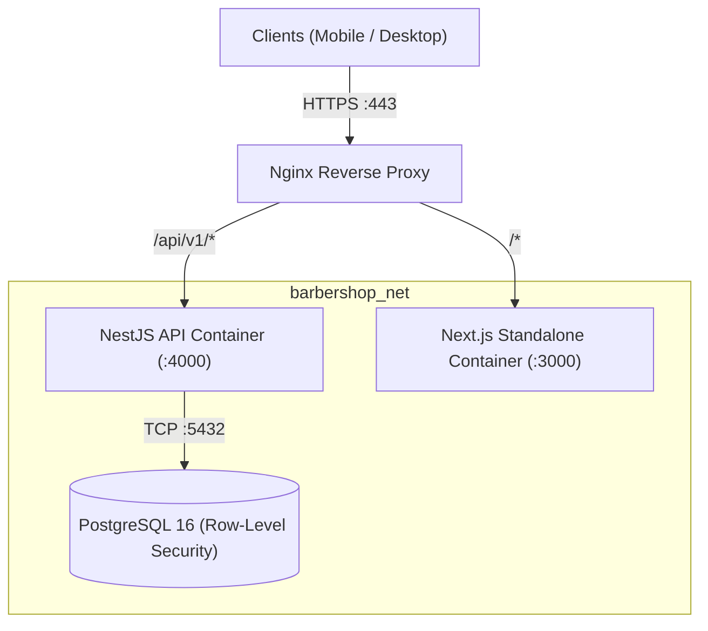

# Production Deployment Guide 🚀

This document provides complete instructions for deploying the **Barber Shop Management Software** in production environments.

---

## 📋 Table of Contents
1. [One-Click GitHub Cloud Deployment (Render Blueprint)](#1-one-click-github-cloud-deployment-render-blueprint)
2. [Why Not GitHub Pages?](#2-why-not-github-pages)
3. [Architecture Overview](#3-architecture-overview)
4. [Quickstart with Docker Compose](#4-quickstart-with-docker-compose)
5. [Production Docker Deployment (with Nginx)](#5-production-docker-deployment-with-nginx)
6. [Database Security & Migration Strategy](#6-database-security--migration-strategy)
7. [Automated Database Backups](#7-automated-database-backups)
8. [Cloud Deployment Options](#8-cloud-deployment-options)
   - [A. Single Ubuntu VPS (DigitalOcean / Linode / Hetzner)](#a-single-ubuntu-vps)
   - [B. AWS (ECS Fargate + RDS PostgreSQL)](#b-aws-ecs-fargate--rds-postgresql)
   - [C. Google Cloud Run + Cloud SQL](#c-google-cloud-run--cloud-sql)
9. [Production Security Checklist](#9-production-security-checklist)

---

## 1. One-Click GitHub Cloud Deployment (Render Blueprint)

The Barber Shop platform is configured with Infrastructure-as-Code via [`render.yaml`](../render.yaml) directly in the repository root. This allows you to launch the entire multi-tier system (PostgreSQL 16 DB + NestJS API + Next.js App Router Web) **live on the internet linked directly to your GitHub repository** (`jai0040/Barber-shop`).

### 3-Step Live Cloud Deployment:

1. **Sign in to Render**:
   - Go to [render.com](https://render.com) and click **Sign in with GitHub** using your GitHub account (`jai0040`).

2. **Deploy Blueprint**:
   - In your Render Dashboard, click **New +** -> **Blueprint**.
   - Connect your GitHub repository: `jai0040/Barber-shop`.
   - Render detects [`render.yaml`](../render.yaml) and automatically lists the 3 resources to provision:
     - `barber-db` (PostgreSQL 16 Database)
     - `barber-api` (NestJS REST API & Real-Time SSE Service)
     - `barber-web` (Next.js Customer Booking & Admin Management Portal)

3. **Click Apply**:
   - Click **Apply Blueprint**.
   - Render automatically:
     - Provisions the managed PostgreSQL instance.
     - Runs database migrations (`node dist/db/migrate-cli.js`).
     - Seeds initial demo data & business hours (`node dist/cli-seed-demo.js`).
     - Compiles the Next.js frontend and exposes both services on public HTTPS URLs (e.g. `https://barber-web-xxxx.onrender.com`).
     - Enables **Continuous Deployment**: Every `git push origin main` on your GitHub account automatically builds and redeploys live!

---

## 2. Why Not GitHub Pages?

GitHub Pages is designed **strictly for static files** (HTML, CSS, client-only JS). It cannot host:
- Live database connections (PostgreSQL 16 socket pools, transaction isolation, btree_gist exclusion constraints).
- Server-side runtime execution (Node.js NestJS API, password hashing with Argon2, JWT token rotation).
- Real-Time Server-Sent Events (SSE) connections.
- Secure environment variables and database credentials.

By linking Render or Railway to your GitHub repository, you get the same developer experience as GitHub Pages (pushing code to GitHub auto-deploys), but with full enterprise cloud compute and managed database support.

---

---

## 1. Architecture Overview



- **Next.js Standalone**: Minimal Alpine image running `apps/web/server.js` with output standalone optimization (~110MB).
- **NestJS API**: High-performance Node.js Alpine container with Argon2 password hashing, rate limiting, and RBAC guards.
- **PostgreSQL 16**: Strict multi-tenant isolation enforced via PostgreSQL Row-Level Security (`shop_id = app_shop_id()`) and `btree_gist` anti-double-booking constraints.
- **Nginx**: Handles SSL termination, gzip compression, HTTP security headers, and reverse proxy routing.

---

## 2. Quickstart with Docker Compose

For local testing of the containerized stack:

```bash
# 1. Clone repository
git clone <repo-url>
cd "Barber shop"

# 2. Build and start containers
docker compose up --build -d

# 3. View live logs
docker compose logs -f
```

The application will be accessible at:
- Web Application: [http://localhost:3000](http://localhost:3000)
- REST API: [http://localhost:4000/api/v1/health](http://localhost:4000/api/v1/health)

---

## 3. Production Docker Deployment (with Nginx)

For a production server (Ubuntu 22.04 / 24.04 LTS):

### Step 1: Create Environment File
```bash
cp .env.production.example .env.production
```
Edit `.env.production` with your production domains and generated secrets:
```bash
# Generate high-entropy secrets
openssl rand -base64 32 # for JWT_ACCESS_SECRET
openssl rand -base64 32 # for JWT_REFRESH_SECRET
openssl rand -base64 24 # for POSTGRES_PASSWORD
```

### Step 2: Configure SSL with Let's Encrypt / Certbot
On your host server, install Certbot:
```bash
sudo apt update && sudo apt install certbot -y
sudo certbot certonly --standalone -d yourbarbershop.com
```

Mount certificates into `nginx/nginx.conf`:
```nginx
server {
    listen 443 ssl http2;
    server_name yourbarbershop.com;

    ssl_certificate /etc/letsencrypt/live/yourbarbershop.com/fullchain.pem;
    ssl_certificate_key /etc/letsencrypt/live/yourbarbershop.com/privkey.pem;
    ssl_protocols TLSv1.2 TLSv1.3;
    ssl_ciphers HIGH:!aNULL:!MD5;
    ...
}
```

### Step 3: Launch Production Stack
```bash
docker compose -f docker-compose.prod.yml --env-file .env.production up --build -d
```

---

## 4. Database Security & Migration Strategy

The system enforces **Principle of Least Privilege** using two distinct database roles:

| Database URL Variable | Role | Privileges | Purpose |
| :--- | :--- | :--- | :--- |
| `MIGRATION_DATABASE_URL` | `postgres` (Schema Owner) | `SUPERUSER` / `CREATEROLE` | Executes DDL migrations, creates tables, enables RLS, creates the app role |
| `DATABASE_URL` | `barber_app` (Application) | Restricted `SELECT`, `INSERT`, `UPDATE` (No `SUPERUSER`, No `BYPASSRLS`, No `DELETE` on ledgers) | Used by the running NestJS API for tenant transactions |

### Migration Execution
Migrations run automatically on container startup via `apps/api/docker-entrypoint.sh`:
```bash
# To run migrations manually at any time:
docker compose exec api node dist/db/migrate-cli.js
```

---

## 5. Automated Database Backups

Create a daily automated backup script `/usr/local/bin/backup-barbershop.sh`:

```bash
#!/bin/bash
set -e

BACKUP_DIR="/var/backups/barbershop"
DATE=$(date +%Y%m%d_%H%M%S)
FILENAME="${BACKUP_DIR}/barbershop_${DATE}.sql.gz"

mkdir -p "$BACKUP_DIR"

# Execute pg_dump from postgres container
docker compose exec -T postgres pg_dump -U postgres barbershop | gzip > "$FILENAME"

# Retain backups for 30 days
find "$BACKUP_DIR" -type f -name "*.sql.gz" -mtime +30 -delete

echo "Backup created successfully: $FILENAME"
```

Add to crontab (`crontab -e`):
```cron
# Run daily at 02:00 AM
0 2 * * * /usr/local/bin/backup-barbershop.sh >> /var/log/barbershop-backup.log 2>&1
```

---

## 6. Cloud Deployment Options

### A. Single Ubuntu VPS
1. Install Docker & Docker Compose plugin:
   ```bash
   curl -fsSL https://get.docker.com | sh
   sudo usermod -aG docker $USER
   ```
2. Clone repo and run `docker compose -f docker-compose.prod.yml up -d`.

### B. AWS (ECS Fargate + RDS PostgreSQL)
1. **Database**: Provision Amazon RDS PostgreSQL 16 (Multi-AZ recommended for HA). Enable `btree_gist` extension.
2. **Container Registry**: Push API and Web images to Amazon ECR.
3. **Compute**: Create an ECS Task Definition with two containers (`api` and `web`) on AWS Fargate.
4. **Load Balancer**: Use Application Load Balancer (ALB) routing `/api/v1/*` to the API target group and `/*` to the Web target group with ACM SSL certificate.

### C. Google Cloud Run + Cloud SQL
1. **Database**: Provision Google Cloud SQL for PostgreSQL.
2. **Compute**: Deploy API as a Cloud Run service and Web as a separate Cloud Run service.
3. **Domains**: Route domains using Google Cloud Load Balancing or Firebase Hosting rewrites.

---

## 7. Production Security Checklist

- [ ] **Secrets**: All passwords and JWT secrets in `.env.production` are randomly generated (minimum 32 characters).
- [ ] **Least Privilege Role**: The API runs under `barber_app` without `BYPASSRLS`.
- [ ] **CORS**: `CORS_ORIGIN` is locked to the exact production domain (no `*` wildcard).
- [ ] **HTTPS / HSTS**: All traffic is redirected to HTTPS with `Strict-Transport-Security` header enabled.
- [ ] **Rate Limiting**: NestJS throttler guard active (default 50 requests/min on public routes, 5 attempts on `/auth/login`).
- [ ] **Image Pipeline**: Photo & logo uploads decoded and re-encoded server-side with Sharp (EXIF metadata stripped).
- [ ] **Backups**: Daily offsite automated backup verified and test-restored.
